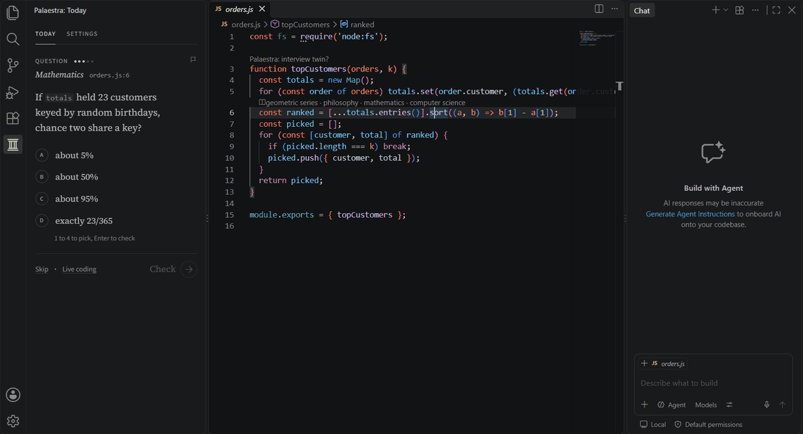
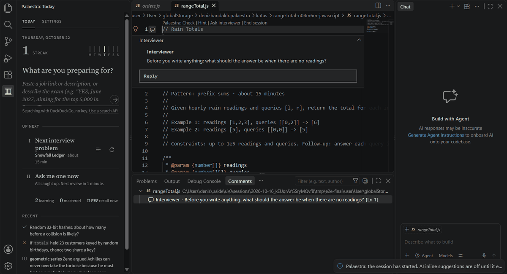
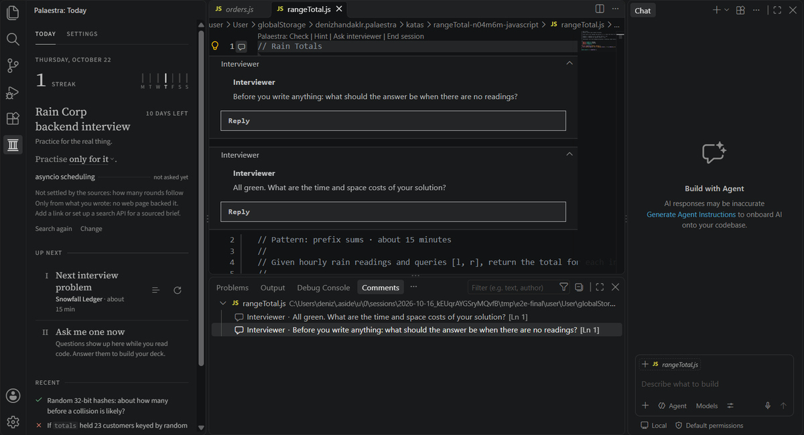
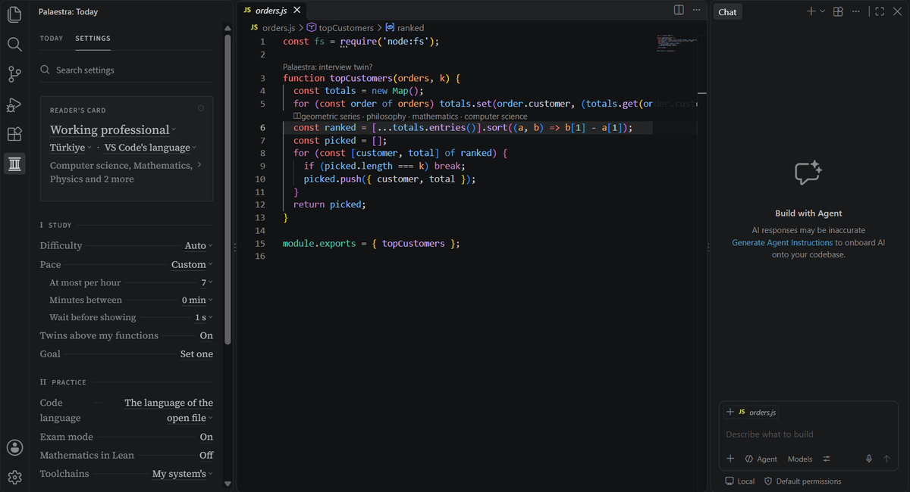

# Palaestra

Palaestra is a practice gym inside your editor, for interviews, exams and engineering. It works in VS Code, Cursor, Antigravity IDE, VSCodium and other VS Code forks, on the models you already have: Copilot Chat's in VS Code, or any model API with your own key (OpenRouter, OpenAI, Gemini, DeepSeek, Z.ai, Kimi, MiniMax, Command Code, Ollama Cloud, a local Ollama or LM Studio).

You get 15 questions and 2 live coding rounds free. After that it costs $10, once, plus tax where your country charges it. No subscription: the key works on up to 10 of your devices and never expires. [Buy Palaestra ($10)](https://buy.polar.sh/polar_cl_KoRtqbSSRC7IHgbKQMr2QLvwqb5HylJauOESJ2ASZIH)

## Questions while you work

Rest on a line of code and a question about it shows up in the sidebar: what this code returns, what breaks it, what it really costs. Or questions on your own subjects, from YKS and the SAT to JEE, the Gaokao, olympiads, university finals and interview rounds. Some you answer by picking, some by typing the answer into a blank, and some in a few sentences, the way an interviewer's "how would you..." is answered.

Every question is measured against the real assessment you named. A second model solves it blind first, and anything wrong, ambiguous or beneath the target is thrown out. Numeric answers are worked out by a program before you see them, and figures are drawn to scale.

When you miss, you get a short lesson on why your answer looked right and what's true, then a similar question. Everything you answer goes into a spaced-repetition deck, and reviews ask the same idea in a new form, so you remember the idea, not the answer.

## Live coding rounds

Problems open in your editor, in your language (Python, JavaScript, TypeScript, Java, Kotlin, C#, C++, Go, Rust, Ruby or PHP), judged on hidden tests. An interviewer watches as you write and talks in comments on your lines: it asks about the edge case your code will get wrong, nudges when you're stuck, asks for the complexity once the tests pass, and gives you a debrief at the end. It never writes the code for you.

Rounds are as mixed as real ones: quick practical questions, mediums and hard ones. There are pairs of problems in one round, practical builds in four levels, bugs to fix and features to add in a real codebase, system design, DevOps tasks on real config files, contest problems with a real judge, and proofs in Lean.

## Prepare for something real

Paste a job link or describe the exam. Palaestra reads the pages, searches the web for the current format, and writes a brief in which every fact quotes its source. Questions and problems then follow it.

## Settings

Your stage, subjects and pace, the models that write, check and tutor, and each one's thinking effort. Models and effort levels are read from your provider and from models.dev, so new ones show up without an update. API keys are kept in your editor's secret storage.

## License and devices

A license works on up to 10 devices. To move it, run **Palaestra: Remove License Key** on the old one, or remove a device in your [Polar account](https://polar.sh/lodestar-vscode/portal).

## Issues

Found a bug or a question that's wrong? [Open an issue](https://github.com/zelosleone/Palaestra/issues). You can also flag a wrong question right on its card.
